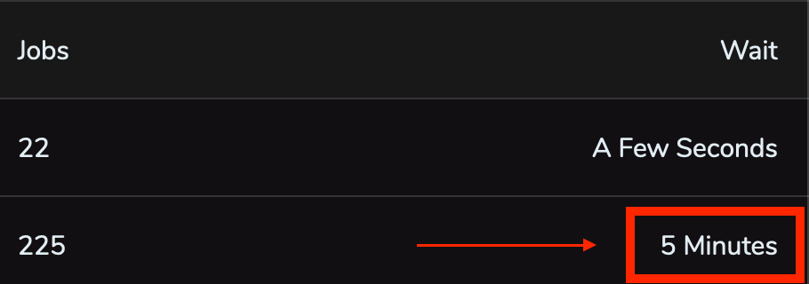
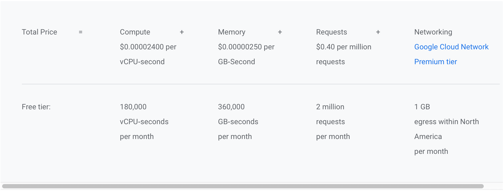
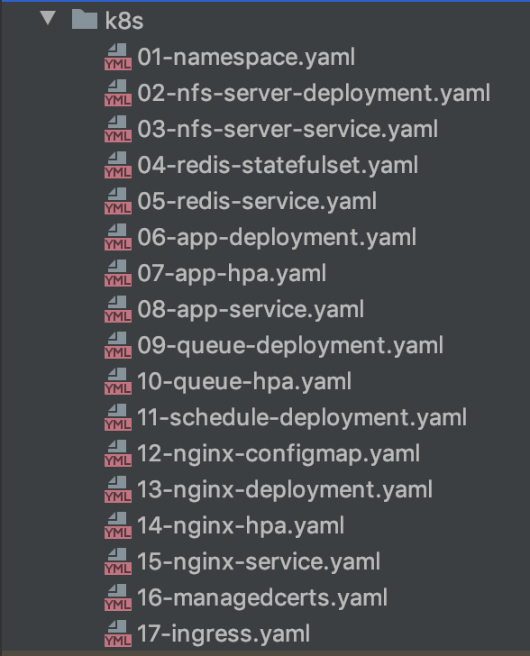
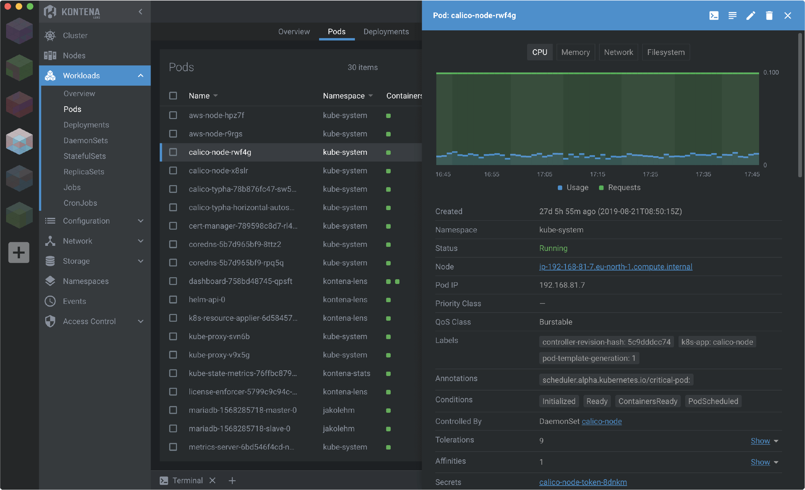
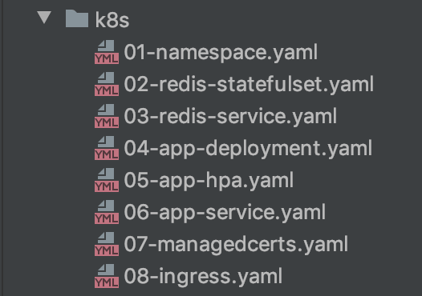

In this article I show how I prepared multiple applications for deployment in a single Kubernetes cluster, and also: why I chose Kubernetes, the benefits, the difficulties I ran into, and the next steps.

## The initial problem

We have at least 5 main applications running on [Google Cloud Platform (GCP)](https://cloud.google.com), along with a few functions that were split out of an API and now run on [Google Functions](https://cloud.google.com/functions), called by the main applications.

Three of these main applications ran individually (one application per VM) on n1-standard-1 VMs (1 vCPU and 3.75 GB of RAM). All applications were containerized, and deploying to production was as simple as:

```bash
docker-compose up -d
```

Even with the whole deployment process automated and causing no headaches, the `waste of resources` by two applications and the `lack of available resources` for another application bothered me:

- One of the applications (an administration panel, with only a few people accessing it) used at most 20% of the CPU across
  all containers (nginx, app, schedule, queue, redis, certbot), and at most 2 of the 3.75 GB of RAM.
- A second application had metrics and a situation very similar to the one above.
- A third application was in the opposite situation, with metrics suggesting a VM upgrade to at least 6 GB
  of RAM. This application runs jobs in queues. It can go a few minutes without receiving a new job, but when a new job arrives, it needs to process everything quickly. It can also receive new jobs while processing the previous ones, and needs to start those new jobs without waiting. In the framework used by this application (Laravel), each worker uses at least 32 MB of RAM. If we configure a maximum of 120 workers, we already need at least 3840 MB of RAM, exceeding this VM's 3.75 GB. On top of that, even 120 workers often weren't enough to get things done quickly, causing a long wait time for jobs in the queues:



  This application definitely needed more resources, while the other two mentioned above weren't using all the resources available to them.

- A fourth application, an MVP (_Minimum viable product_) running in a single container on [cloud.run](https://cloud.run), had already been validated and needed to grow with the addition of queues and caching. Since cloud.run is designed for _stateless_ content and doesn't have access to Redis (at least not easily, without exposing Redis from a VM, for example), we needed to move it out of there.

- A fifth application, also running in a single container, worked well on cloud.run and, unlike the previous one, didn't need queues. However, because it received a lot of traffic on cloud.run and each request used a lot of CPU time, the cloud.run costs started to bother me (below are the cloud.run prices with and without the free tier):



A viable solution for making better use of resources would be to run the applications in a cluster. This would let us control how much hardware to dedicate to each application and make it possible to scale the third application mentioned earlier. To orchestrate the containers in the cluster, I would have to choose carefully between two of the available options: Swarm or Kubernetes, since I already had some knowledge of both tools.

## Why Kubernetes?

Managing a cluster is hard. Applying security patches, automatic repair, automatic upgrades, autoscaling, and ensuring
availability are just a few examples of what we would have to maintain if we decided to manage it ourselves.

Of the cluster options mentioned earlier (Swarm and Kubernetes), our cloud provider only offers a managed Kubernetes service (in my opinion, one of the best and most robust, maybe because they designed Kubernetes and most of their services run on it). The service is Google Kubernetes Engine (GKE), and it [offers a free plan for a zonal cluster](https://cloud.google.com/kubernetes-engine#pricing), which meets our needs.

The estimated costs:

- 2 [e2-standard-2](https://cloud.google.com/blog/products/compute/google-compute-engine-gets-new-e2-vm-machine-types) VMs with 2 vCPUs and 8 GB of RAM each, giving us a cluster with 4 vCPUs and 16 GB of RAM. With a 3-year [committed use discount](https://cloud.google.com/compute/docs/instances/signing-up-committed-use-discounts), the estimated monthly cost is around `45 USD`.
- An HTTP/HTTPS load balancer, with 1 to 5 forwarding rules, costs around `18 USD`.

Databases, buckets, and other managed Google services aren't included in this calculation because they weren't changed and their costs stayed the same.

## Creating the Kubernetes cluster

We can create the cluster in GKE through the [Google Cloud Console](https://console.cloud.google.com/kubernetes/) or from the command line on our machine:

> Have gcloud and kubectl installed beforehand.

> Replace `yourclustername`, `yourprojectname`, `yourregion` (for example, southamerica-east1 for São Paulo), `yourregion-zone` (for example, southamerica-east1-a for São Paulo, zone a), and `yournetwork` with the appropriate values.

```bash
gcloud container \
  clusters create "yourclustername" \
  --project "yourprojectname" \
  --zone "yourregion-zone" \
  --no-enable-basic-auth \
  --release-channel "regular" \
  --machine-type "e2-standard-2" \
  --image-type "COS" \
  --disk-type "pd-ssd" \
  --disk-size "20" \
  --metadata disable-legacy-endpoints=true \
  --scopes "https://www.googleapis.com/auth/devstorage.read_only","https://www.googleapis.com/auth/logging.write","https://www.googleapis.com/auth/monitoring","https://www.googleapis.com/auth/servicecontrol","https://www.googleapis.com/auth/service.management.readonly","https://www.googleapis.com/auth/trace.append" \
  --num-nodes "2" \
  --enable-stackdriver-kubernetes \
  --enable-ip-alias \
  --network "projects/yourprojectname/global/networks/yournetwork" \
  --subnetwork "projects/yourprojectname/regions/yourregion/subnetworks/yournetwork" \
  --default-max-pods-per-node "110" \
  --enable-autoscaling \
  --min-nodes "2" \
  --max-nodes "3" \
  --no-enable-master-authorized-networks \
  --addons HorizontalPodAutoscaling,HttpLoadBalancing,NodeLocalDNS,ApplicationManager \
  --enable-autoupgrade \
  --enable-autorepair \
  --max-surge-upgrade 1 \
  --max-unavailable-upgrade 0 \
  --enable-shielded-nodes
```

We define a minimum of 2 nodes using e2-standard-2 machines (the machines covered by the committed use discount mentioned earlier), and a maximum of 3 nodes.

Change the `kubectl` context to GKE:

```bash
kubectl config set-context gke_yourprojectname_yourregion-zone_yourclustername
```

## Preparing the containers

As mentioned in the first section, the applications were already containerized. One container dedicated to the web application, one for the queues, one for running scheduled tasks, a Redis container, and an nginx container. The certbot container was dropped because we adopted a different approach to managing SSL certificates.

If you haven't containerized your application yet, prepare it to follow the [Twelve-Factor App](https://12factor.net).

## Preparing the manifests

Here comes the first shock for anyone used to bringing up the entire production environment with a single
docker-compose.yaml file 🙃



I'll show the purpose of each file. For details and Kubernetes concepts, see its [documentation](https://kubernetes.io/docs/concepts/).

The application's infrastructure is defined as code. Kubernetes controllers keep checking `whether the application's current state matches the state defined in code`, and if it doesn't, they apply the necessary changes.

Manifests can be defined in YAML or JSON; the `.yaml`, `.yml`, and `.json` extensions are accepted. I put them all in the same directory to make deployment easier with the command:

```bash
kubectl apply -f k8s/
```

###### 01-namespace.yaml

```yaml
apiVersion: v1
kind: Namespace
metadata:
  name: yourapp1
  labels:
    name: yourapp1

---
apiVersion: v1
kind: ResourceQuota
metadata:
  name: resource-quota
  namespace: yourapp1
spec:
  hard:
    requests.cpu: 300m
    requests.memory: 1536Mi
    limits.cpu: 500m
    limits.memory: 2048Mi
```

In this file I define the application's [Namespace](https://kubernetes.io/docs/concepts/overview/working-with-objects/namespaces/). Namespaces let us define the scope of applications. This makes it possible to run several different applications in the same cluster without them interfering with each other (communication between namespaces is still possible through exposed services, as I'll show). Another use for namespaces is separating `staging` and `production` environments, for example. By default, if no namespace is defined, deployments happen in the `default` namespace.

In the same file I define a [Resource Quota](https://kubernetes.io/docs/concepts/policy/resource-quotas/), where we can define the resource requests and limits for the namespace. In this example, I define:

- `requests.cpu: 300m` - all components in the namespace combined can request at most 300 millicores of CPU (1 vCPU = 1000m; CPU values can be defined starting at 1m).

- `requests.memory: 1536Mi` - all components in the namespace combined can request at most 1536Mi of memory (1 Mebibyte (MiB) = (1024)^2 bytes = 1048576 bytes).

- `limits.cpu: 500m` - all components in the namespace combined (despite being able to request the 300m of CPU defined earlier) can use at most 500 millicores of CPU.

- `limits.memory: 2048Mi` - all components in the namespace combined (despite being able to request the 1536Mi of memory defined earlier) can use at most 2048Mi of memory.

When the defined CPU limits are reached, the application starts experiencing CPU `throttling`, meaning its performance is affected.

When the memory limits are reached, memory can't be "compressed" the way CPU usage can, and its [Pod](https://kubernetes.io/docs/concepts/workloads/pods/pod-overview/) is terminated.

When a new version of your application is deployed, if the CPU or memory limit is exceeded, the pods won't run and will remain in the [Evicted](https://kubernetes.io/docs/tasks/administer-cluster/out-of-resource/#eviction-policy) state.

Defining a ResourceQuota for a namespace is optional, but it ensures that one application doesn't consume too many resources.

###### 02-nfs-server-deployment.yaml

```yaml
apiVersion: apps/v1
kind: Deployment
metadata:
  name: nfs-server
  namespace: yourapp1
spec:
  replicas: 1
  selector:
    matchLabels:
      name: nfs-server
  template:
    metadata:
      labels:
        name: nfs-server
    spec:
      containers:
        - name: nfs-server
          image: gcr.io/google_containers/volume-nfs:latest
          ports:
            - name: nfs
              containerPort: 2049
            - name: mountd
              containerPort: 20048
            - name: rpcbind
              containerPort: 111
          securityContext:
            privileged: true
          resources:
            requests:
              cpu: 1m
              memory: 168Mi
            limits:
              cpu: 2m
              memory: 192Mi
          volumeMounts:
            - name: data
              mountPath: /exports

      volumes:
        - name: data
          gcePersistentDisk:
            pdName: yourapp1-nfs-disk
            fsType: ext4
```

In this file I define the deployment of an NFS volume, since GKE's standard [GCEPersistentDisk](https://kubernetes.io/docs/concepts/storage/persistent-volumes/#access-modes) doesn't support `ReadWriteMany` access, which would let several nodes read and write at the same time.

This volume will be used to persist Redis data and also the static pages generated by the app container and shared with the nginx container.

A few details about the file:

- The namespace must be the same one defined earlier so that the deployment is scoped to the same namespace.
- It has only one replica.
- The CPU requests and limits for this deployment can be very small (I'll show how to analyze them later).
- The volume is mounted at the /exports path on the disk.
- The disk defined in `pdName` under volumes must be created beforehand with:

```bash
gcloud compute disks create --size=1GB --zone=yourregion-zone --type=pd-ssd yourapp1-nfs-disk
```

###### 03-nfs-server-service.yaml

```yaml
apiVersion: v1
kind: Service
metadata:
  name: nfs-server
  namespace: yourapp1
spec:
  ports:
    - name: nfs
      port: 2049
    - name: mountd
      port: 20048
    - name: rpcbind
      port: 111
  selector:
    name: nfs-server
```

The service above is responsible for [exposing the deployment created earlier so that other pods can access it](https://kubernetes.io/docs/concepts/services-networking/service/). The service is exposed using ClusterIP, only to other pods, not to the internet.

Remember to set the service's `selector` to the same value defined in the deployment selector's `labels`.

###### 04-redis-statefulset.yaml

```yaml
apiVersion: apps/v1
kind: StatefulSet
metadata:
  name: redis
  namespace: yourapp1
spec:
  serviceName: redis
  selector:
    matchLabels:
      name: redis
  template:
    metadata:
      name: redis
      labels:
        name: redis
    spec:
      containers:
        - name: redis
          image: redis:5.0.5-alpine
          ports:
            - containerPort: 6379
          resources:
            requests:
              cpu: 5m
              memory: 14Mi
            limits:
              cpu: 5m
              memory: 16Mi
          volumeMounts:
            - name: data
              mountPath: /data
      volumes:
        - name: data
          nfs:
            server: nfs-server.yourapp1.svc.cluster.local
            path: "/redis/data"
```

The Redis deployment is a [StatefulSet](https://kubernetes.io/docs/concepts/workloads/controllers/statefulset/). The volume can directly access the service deployed earlier through `<service>`.`<namespace>`.svc.cluster.local.

###### 05-redis-service.yaml

```yaml
apiVersion: v1
kind: Service
metadata:
  name: redis
  namespace: yourapp1
spec:
  ports:
    - port: 6379
      protocol: TCP
  selector:
    name: redis
```

Exposes Redis using ClusterIP so that other pods can access it.

###### 06-app-deployment.yaml

```yaml
apiVersion: apps/v1
kind: Deployment
metadata:
  name: app
  namespace: yourapp1
  labels:
    name: app
  annotations:
    secret.reloader.stakater.com/reload: "env"
spec:
  replicas: 2
  revisionHistoryLimit: 1
  selector:
    matchLabels:
      name: app
  strategy:
    type: RollingUpdate
    rollingUpdate:
      maxSurge: 1
      maxUnavailable: 50%
  template:
    metadata:
      labels:
        name: app
    spec:
      containers:
        - name: app
          image: gcr.io/yourproject/yourapp1:TAG_NAME
          command: ["/bin/bash"]
          args:
            - -c
            - |
              sleep 12
              php artisan migrate --force
              php artisan optimize
              php artisan view:cache
              ln -s public html
              ln -s /var/www /usr/share/nginx
              /usr/local/sbin/php-fpm
          envFrom:
            - secretRef:
                name: env
          readinessProbe:
            initialDelaySeconds: 20
            periodSeconds: 10
            timeoutSeconds: 5
            failureThreshold: 3
            successThreshold: 1
            tcpSocket:
              port: 9000
          ports:
            - containerPort: 9000
          resources:
            requests:
              cpu: 20m
              memory: 320Mi
            limits:
              cpu: 50m
              memory: 512Mi
          volumeMounts:
            - name: static
              mountPath: /static
            - name: cache-html
              mountPath: /var/www/public/cache-html
          lifecycle:
            postStart:
              exec:
                command: ["/bin/bash", "-c", "cp -r /var/www/public/. /static"]

        - name: cloudsql-proxy
          image: gcr.io/cloudsql-docker/gce-proxy:latest
          command:
            [
              "/cloud_sql_proxy",
              "-instances=yourproject:cloudsql-region:yourproject=tcp:5432",
              "-credential_file=/secrets/cloudsql/cloudsqlproxy.json",
            ]
          resources:
            requests:
              cpu: 1m
              memory: 8Mi
            limits:
              cpu: 10m
              memory: 16Mi
          volumeMounts:
            - name: cloudsql-instance-credentials
              mountPath: /secrets/cloudsql
              readOnly: true

      volumes:
        - name: static
          nfs:
            server: nfs-server.yourapp1.svc.cluster.local
            path: "/static"
        - name: cache-html
          nfs:
            server: nfs-server.yourapp1.svc.cluster.local
            path: "/cache-html"
        - name: cloudsql-instance-credentials
          secret:
            secretName: cloudsql-instance-credentials
```

Responsible for deploying the Laravel application with FPM. Under `annotations`, we have a `secret.reloader.stakater.com/reload: "env"` annotation that will deploy a new pod `whenever the secret named env` is updated. This isn't standard Kubernetes behavior. To enable it, we install a controller called [Reloader](https://github.com/stakater/Reloader) with the command:

```bash
kubectl apply -f https://raw.githubusercontent.com/stakater/Reloader/master/deployments/kubernetes/reloader.yaml
```

- `replicas: 2` - we define that the deployment will create 2 pods.
- `revisionHistoryLimit: 1` - we'll only have access to one version before the current one for rollback.

Under `strategy`:

- `type: RollingUpdate` - our deployment uses a [Rolling Update](https://kubernetes.io/docs/concepts/workloads/controllers/deployment/#rolling-update-deployment).
- `maxSurge: 1` - only one extra pod can be created at a time.
- `maxUnavailable: 50%` - at least half of the pods must be available during deployment. In the example with `replicas: 2` and `maxSurge: 1`, a new pod is created, then an old pod is terminated (respecting `maxUnavailable: 50%`), then another new pod is created, and the last old pod is terminated.

Under `containers`:

This pod has 2 containers: the main app and a sidecar (a proxy for connecting to the database in Google Cloud SQL).

In the first container, `app`, we have:

- `commands:` and `args:` - the commands that will be executed by our container. The initial `sleep` waits until the sidecar container is available. From version `1.18` onward, [this sleep will no longer be necessary](https://banzaicloud.com/blog/k8s-sidecars/).
- `envFrom:` - we inject our environment variables (I'll show how to create them in the [Automating testing and deployment with a CI/CD pipeline](#automating-testing-and-deployment-with-a-cicd-pipeline) section).
- `readinessProbe:` - the container will only receive traffic after a successful TCP connection to the container on port 9000.
- `volumeMounts:` - the static volume shares assets between the app and nginx. The cache-html volume stores some pages as static files generated from dynamic content, avoiding the need to render them all the time.

In the `cloudsql-proxy` sidecar container, we authenticate using a secret. I also show how to create it in the [Automating testing and deployment with a CI/CD pipeline](#automating-testing-and-deployment-with-a-cicd-pipeline) section.

###### 07-app-hpa.yaml

```yaml
apiVersion: autoscaling/v2beta1
kind: HorizontalPodAutoscaler
metadata:
  name: app
  namespace: yourapp1
spec:
  maxReplicas: 3
  minReplicas: 1
  scaleTargetRef:
    apiVersion: apps/v1
    kind: Deployment
    name: app
  metrics:
    - type: Resource
      resource:
        name: cpu
        targetAverageUtilization: 90
    - type: Resource
      resource:
        name: memory
        targetAverageUtilization: 90
```

The [Horizontal Pod Autoscaler (HPA)](https://kubernetes.io/docs/tasks/run-application/horizontal-pod-autoscale/) automatically scales the number of pods in our deployment. In the example in [06-app-deployment.yaml](#06-app-deploymentyaml), we deployed two replicas. The HPA above will scale this deployment to 1 or 3 replicas based on the deployment's average CPU and memory usage.

###### 08-app-service.yaml

```yaml
apiVersion: v1
kind: Service
metadata:
  name: app
  namespace: yourapp1
  labels:
    name: app
spec:
  ports:
    - protocol: TCP
      port: 9000
  selector:
    name: app
```

Exposes the app using ClusterIP so that other pods can access it.

###### 09-queue-deployment.yaml

```yaml
apiVersion: apps/v1
kind: Deployment
metadata:
  name: queue
  namespace: yourapp1
  labels:
    name: queue
  annotations:
    secret.reloader.stakater.com/reload: "env"
spec:
  replicas: 1
  revisionHistoryLimit: 1
  selector:
    matchLabels:
      name: queue
  strategy:
    type: RollingUpdate
    rollingUpdate:
      maxSurge: 1
      maxUnavailable: 50%
  template:
    metadata:
      labels:
        name: queue
    spec:
      containers:
        - name: queue
          image: gcr.io/yourproject/yourapp1:TAG_NAME
          command: ["/bin/bash"]
          args:
            - -c
            - |
              php artisan config:cache
              php artisan horizon --quiet
          envFrom:
            - secretRef:
                name: env
          resources:
            requests:
              cpu: 100m
              memory: 128Mi
            limits:
              cpu: 150m
              memory: 512Mi

        - name: cloudsql-proxy
          image: gcr.io/cloudsql-docker/gce-proxy:latest
          command:
            [
              "/cloud_sql_proxy",
              "-instances=yourproject:cloudsql-region:yourproject=tcp:5432",
              "-credential_file=/secrets/cloudsql/cloudsqlproxy.json",
            ]
          resources:
            requests:
              cpu: 1m
              memory: 8Mi
            limits:
              cpu: 10m
              memory: 16Mi
          volumeMounts:
            - name: cloudsql-instance-credentials
              mountPath: /secrets/cloudsql
              readOnly: true

      volumes:
        - name: cloudsql-instance-credentials
          secret:
            secretName: cloudsql-instance-credentials
```

The concepts are the same as in [06-app-deployment.yaml](#06-app-deploymentyaml), but we start with only one replica, and the HPA below controls the need for additional replicas.

###### 10-queue-hpa.yaml

```yaml
apiVersion: autoscaling/v2beta1
kind: HorizontalPodAutoscaler
metadata:
  name: queue
  namespace: yourapp1
spec:
  maxReplicas: 2
  minReplicas: 1
  scaleTargetRef:
    apiVersion: apps/v1
    kind: Deployment
    name: queue
  metrics:
    - type: Resource
      resource:
        name: cpu
        targetAverageUtilization: 100
    - type: Resource
      resource:
        name: memory
        targetAverageUtilization: 90
```

The concepts are the same as in [07-app-hpa.yaml](#07-app-hpayaml), but for the queue.

###### 11-schedule-deployment.yaml

```yaml
apiVersion: apps/v1
kind: Deployment
metadata:
  name: schedule
  namespace: yourapp1
  labels:
    name: schedule
  annotations:
    secret.reloader.stakater.com/reload: "env"
spec:
  replicas: 1
  revisionHistoryLimit: 1
  selector:
    matchLabels:
      name: schedule
  template:
    metadata:
      labels:
        name: schedule
    spec:
      containers:
        - name: schedule
          image: gcr.io/yourproject/yourapp1:TAG_NAME
          command: ["/bin/bash"]
          args:
            - -c
            - |
              php artisan config:cache
              chmod +x schedule.sh
              /var/www/schedule.sh
          envFrom:
            - secretRef:
                name: env
          resources:
            requests:
              cpu: 10m
              memory: 8Mi
            limits:
              cpu: 30m
              memory: 64Mi

        - name: cloudsql-proxy
          image: gcr.io/cloudsql-docker/gce-proxy:latest
          command:
            [
              "/cloud_sql_proxy",
              "-instances=yourproject:cloudsql-region:yourproject=tcp:5432",
              "-credential_file=/secrets/cloudsql/cloudsqlproxy.json",
            ]
          resources:
            requests:
              cpu: 1m
              memory: 8Mi
            limits:
              cpu: 15m
              memory: 16Mi
          volumeMounts:
            - name: cloudsql-instance-credentials
              mountPath: /secrets/cloudsql
              readOnly: true

      volumes:
        - name: cloudsql-instance-credentials
          secret:
            secretName: cloudsql-instance-credentials
```

If you already use Kubernetes, you've probably thought, "there's a [CronJob](https://kubernetes.io/docs/concepts/workloads/controllers/cron-jobs/) controller for that." Yes, but my cron jobs run every minute. The process of a controller triggering a job, starting a pod, running the container, killing the pod, and doing it all again a few seconds later doesn't sound great to me. [I'm not the only one taking this approach for cron jobs that run every minute](https://youtu.be/MoIdU0J0f0E?t=939).

###### 12-nginx-configmap.yaml

```yaml
apiVersion: v1
kind: ConfigMap
metadata:
  name: nginx-configmap
  namespace: yourapp1
data:
  nginx.conf: |
    user  nginx;
    worker_processes  auto;

    events {
      worker_connections 4096;
      multi_accept on;
      use epoll;
    }

    http {
      include       mime.types;
      server_tokens off;
      default_type  application/octet-stream;

      client_body_buffer_size 10K;
      client_header_buffer_size 1k;
      client_max_body_size 10m;
      large_client_header_buffers 4 16k;

      access_log off;
      error_log /dev/stderr;

      sendfile on;

      keepalive_timeout  65;
      keepalive_requests 100;

      log_format json_combined escape=json
        '{'
          '"time_local":"$time_local",'
          '"remote_addr":"$remote_addr",'
          '"remote_user":"$remote_user",'
          '"request":"$request",'
          '"status": "$status",'
          '"body_bytes_sent":"$body_bytes_sent",'
          '"request_time":"$request_time",'
          '"http_referrer":"$http_referer",'
          '"http_user_agent":"$http_user_agent"'
        '}';

      server {
        listen 80;
        server_name yourapp1.com www.yourapp1.com;
        index index.php index.html;
        root /usr/share/nginx/html;

        if ($host = "www.yourapp1.com") {
          rewrite ^ https://yourapp1.com$request_uri? permanent;
        }

        if ($http_x_forwarded_proto = "http") {
          rewrite ^ https://yourapp1.com$request_uri? permanent;
        }

        add_header 'Referrer-Policy' 'same-origin';
        add_header 'Feature-Policy' "geolocation 'none'; vibrate 'none'";
        add_header 'Strict-Transport-Security' 'max-age=31536000; includeSubdomains; preload';
        add_header 'X-Content-Type-Options' 'nosniff';
        add_header 'X-Frame-Options' 'SAMEORIGIN';
        add_header 'X-XSS-Protection' '1; mode=block';

        gzip on;
        gzip_disable "MSIE [1-6]\.(?!.*SV1)";
        gzip_vary on;
        gzip_proxied any;
        gzip_comp_level 6;
        gzip_buffers 16 8k;
        gzip_http_version 1.1;
        gzip_types text/plain text/css application/json application/x-javascript text/xml application/xml application/xml+rss text/javascript application/javascript text/x-js;

        location ~* \.(js|jpg|jpeg|gif|png|css|tgz|gz|rar|bz2|doc|pdf|ppt|tar|wav|bmp|rtf|swf|ico|flv|txt|woff|woff2|svg|xml)$ {
          root /static;
          expires 365d;
          access_log off;
          etag on;
          if_modified_since exact;
          add_header Pragma "public";
          add_header Cache-Control "max-age=31536000, public";
          add_header Access-Control-Allow-Origin *;
          try_files $uri =404;
        }

        location = / {
          try_files /cache-html/index.html /index.php?$args;
        }

        location ~ ^/(comprar|blog|recompensas|avaliacoes-de-clientes|termos-de-servico|sobre-nos|politica-de-privacidade|politica-de-cancelamento).*$ {
          try_files /cache-html/$uri.html$arg_page $uri $uri/ /index.php?$args;
        }

        location / {
          try_files $uri $uri/ /index.php?$query_string;
        }

        location ~ \.php$ {
          try_files $uri =404;
          fastcgi_split_path_info ^(.+\.php)(/.+)$;
          fastcgi_pass app:9000;
          fastcgi_index index.php;
          include fastcgi_params;
          fastcgi_param SCRIPT_FILENAME $document_root$fastcgi_script_name;
          fastcgi_param PATH_INFO $fastcgi_path_info;
          fastcgi_read_timeout 180;
          proxy_set_header Host            $http_host;
          proxy_set_header X-Real-IP       $remote_addr;
          proxy_set_header X-Forwarded-For $proxy_add_x_forwarded_for;
        }
      }
    }
```

The [ConfigMap](https://kubernetes.io/docs/tasks/configure-pod-container/configure-pod-configmap/) with the nginx configuration used by this application.

###### 13-nginx-deployment.yaml

```yaml
apiVersion: apps/v1
kind: Deployment
metadata:
  name: nginx
  namespace: yourapp1
  annotations:
    configmap.reloader.stakater.com/reload: "nginx-configmap"
spec:
  replicas: 1
  selector:
    matchLabels:
      name: nginx
  template:
    metadata:
      labels:
        name: nginx
    spec:
      containers:
        - name: nginx
          image: nginx:1.17-alpine
          command:
            [
              "/bin/sh",
              "-c",
              "touch /usr/share/nginx/html/index.php; nginx -g 'daemon off;'",
            ]
          resources:
            requests:
              cpu: 1m
              memory: 16Mi
            limits:
              cpu: 2m
              memory: 32Mi
          ports:
            - containerPort: 80
          volumeMounts:
            - name: nginx-configmap
              mountPath: /etc/nginx/nginx.conf
              subPath: nginx.conf
              readOnly: true
            - name: static
              mountPath: /static
            - name: cache-html
              mountPath: /usr/share/nginx/html/cache-html

      volumes:
        - name: nginx-configmap
          configMap:
            name: nginx-configmap
            items:
              - key: nginx.conf
                path: nginx.conf
        - name: static
          nfs:
            server: nfs-server.yourapp1.svc.cluster.local
            path: "/static"
        - name: cache-html
          nfs:
            server: nfs-server.yourapp1.svc.cluster.local
            path: "/cache-html"
```

The nginx deployment uses the nfs-server created in [step 2](#02-nfs-server-deploymentyaml) and exposed in [step 3](#03-nfs-server-serviceyaml). It will have access to the content shared by [step 6](#06-app-deploymentyaml). It also uses the nginx-configmap created in the previous step.

###### 14-nginx-hpa.yaml

```yaml
apiVersion: autoscaling/v2beta1
kind: HorizontalPodAutoscaler
metadata:
  name: nginx
  namespace: yourapp1
spec:
  maxReplicas: 2
  minReplicas: 1
  scaleTargetRef:
    apiVersion: apps/v1
    kind: Deployment
    name: nginx
  metrics:
    - type: Resource
      resource:
        name: cpu
        targetAverageUtilization: 90
    - type: Resource
      resource:
        name: memory
        targetAverageUtilization: 90
```

The concepts are the same as in [07-app-hpa.yaml](#07-app-hpayaml), but for nginx.

###### 15-nginx-service.yaml

```yaml
apiVersion: v1
kind: Service
metadata:
  name: nginx
  namespace: yourapp1
spec:
  type: NodePort
  ports:
    - port: 80
      targetPort: 80
  selector:
    name: nginx
```

Exposes nginx using the NodePort type so that it can be accessed from the internet.

###### 16-managedcerts.yaml

```yaml
apiVersion: networking.gke.io/v1beta1
kind: ManagedCertificate
metadata:
  name: yourapp1-com
  namespace: yourapp1
spec:
  domains:
    - yourapp1.com

---
apiVersion: networking.gke.io/v1beta1
kind: ManagedCertificate
metadata:
  name: www-yourapp-com
  namespace: yourapp1
spec:
  domains:
    - www.yourapp1.com
```

The SSL certificates managed automatically by Google. More details in the [Adding Google-managed SSL certificates](#adding-google-managed-ssl-certificates) section.

###### 17-ingress.yaml

```yaml
apiVersion: networking.k8s.io/v1beta1
kind: Ingress
metadata:
  name: nginx
  namespace: yourapp1
  annotations:
    kubernetes.io/ingress.global-static-ip-name: yourapp1-global-ip-name
    networking.gke.io/managed-certificates: yourapp1-com,www-yourapp1-com
spec:
  backend:
    serviceName: nginx
    servicePort: 80
```

We'll create a global IP address for the application:

```bash
gcloud compute addresses create yourapp1-global-ip-name --global
```

The ingress will expose the application to the internet. Under `annotations`, we add the name of the global IP created above and the name of the managed certificates created in the previous step. Under `spec`, we define that all requests will be forwarded to the nginx service on port 80, created in [15-nginx-service.yaml](#15-nginx-serviceyaml).

Behind the scenes, a load balancer is created with two forwarding rules (HTTP and HTTPS) pointing to this ingress and its `spec`.

## Adding Google-managed SSL certificates

Create a DNS zone:

https://cloud.google.com/dns/docs/

Point the NS records at your domain registrar to the ones shown in the DNS zone created above.

Point the A record to the IP created earlier in [17-ingress.yaml](#17-ingressyaml). Get the IP with the command:

```bash
gcloud compute addresses \
  describe yourapp1-global-ip-name --global \
  --format='value(address)'
```

Use the command `host yourapp1.com` to check whether it's already pointing to the IP created earlier.

During deployment, when the [16-managedcerts.yaml](#16-managedcertsyaml) file is applied (`kubectl apply -f 16-managedcerts.yaml`), certificate generation will take 15 to 30 minutes.

## Deploying the manifests

We can deploy one file at a time:

```bash
kubectl apply -f 01-namespace.yaml
kubectl apply -f 02-nfs-server-deployment.yaml
```

Or all files in the directory:

```bash
kubectl apply -f k8s/
```

The same applies to deletion with `kubectl delete`.

## Automating testing and deployment with a CI/CD pipeline

[Google KMS](https://cloud.google.com/kms) is a service for managing cryptographic keys. With it, we can encrypt configuration files/environment variables and `even add them to version control` safely, since they'll be encrypted.

After [enabling the KMS API](https://console.developers.google.com/apis/library/cloudkms.googleapis.com), create a keyring:

```bash
gcloud kms keyrings create yourkeyringname --location global
```

Create a key:

```bash
gcloud kms keys create yourkeyname --location global --keyring yourkeyringname --purpose encryption
```

Encrypt the configuration files/environment variables you want:

```bash
gcloud kms encrypt --location global \
  --keyring yourkeyringname --key yourkeyname \
  --plaintext-file .env.prod \
  --ciphertext-file .env.prod.enc
```

```bash
gcloud kms encrypt --location global \
  --keyring yourkeyringname --key yourkeyname \
  --plaintext-file cloudsqlproxy.json \
  --ciphertext-file cloudsqlproxy.json.enc
```

> The example below is only necessary if you have a private package such as [Laravel Nova](https://nova.laravel.com).

```bash
gcloud kms encrypt --location global \
  --keyring yourkeyringname --key yourkeyname \
  --plaintext-file auth.json \
  --ciphertext-file auth.json.enc
```

Now both can be safely committed :)

I use [Cloud Build](https://cloud.google.com/cloud-build/) for the CI/CD process. I split the processes into two [triggers](https://console.cloud.google.com/cloud-build/triggers) and two files: `cloudbuild.ci.yaml` and `cloudbuild.cd.yaml`. Remember to add the `substitution variables` to the triggers created in Cloud Build:

- `_CLUSTER` - your cluster's name
- `_KEY` - your KMS key created earlier
- `_KEYRING` - your keyring created earlier
- `_ZONE` - yourregion-zone

###### cloudbuild.ci.yaml

```yaml
steps:
  - id: "Decrypt auth.json"
    name: gcr.io/cloud-builders/gcloud
    args:
      - kms
      - decrypt
      - --ciphertext-file=auth.json.enc
      - --plaintext-file=auth.json
      - --location=global
      - --keyring=$_KEYRING
      - --key=$_KEY

  - id: "Copy .env file"
    name: gcr.io/cloud-builders/gsutil
    args: ["cp", ".env.testing", ".env"]

  - id: "Up"
    name: docker/compose:1.24.0
    args: ["-f", "docker-compose.testing.yml", "up", "-d", "app"]

  - id: "Install dependencies"
    name: gcr.io/cloud-builders/docker
    args:
      [
        "exec",
        "-t",
        "app",
        "composer",
        "install",
        "--no-interaction",
        "--no-ansi",
        "--no-progress",
        "--prefer-dist",
        "--optimize-autoloader",
      ]

  - id: "Duplicated code analysis"
    name: gcr.io/cloud-builders/docker
    waitFor: ["Install dependencies"]
    args: ["exec", "-t", "app", "composer", "phpcpd"]

  - id: "Lint analysis"
    name: gcr.io/cloud-builders/docker
    waitFor: ["Install dependencies"]
    args: ["exec", "-t", "app", "composer", "lint"]

  - id: "Code quality and code style analysis"
    name: gcr.io/cloud-builders/docker
    waitFor: ["Install dependencies"]
    args: ["exec", "-t", "app", "composer", "insights"]

  - id: "Run tests"
    name: gcr.io/cloud-builders/docker
    waitFor: ["Install dependencies"]
    args: ["exec", "-t", "app", "composer", "test"]
```

###### cloudbuild.cd.yaml

```yaml
steps:
  - id: "Decrypt .env"
    name: gcr.io/cloud-builders/gcloud
    args:
      - kms
      - decrypt
      - --ciphertext-file=.env.prod.enc
      - --plaintext-file=.env
      - --location=global
      - --keyring=$_KEYRING
      - --key=$_KEY

  - id: "Decrypt cloudsqlproxy.json service account"
    name: gcr.io/cloud-builders/gcloud
    args:
      - kms
      - decrypt
      - --ciphertext-file=cloudsqlproxy.json.enc
      - --plaintext-file=cloudsqlproxy.json
      - --location=global
      - --keyring=$_KEYRING
      - --key=$_KEY

  - id: "Decrypt auth.json"
    name: gcr.io/cloud-builders/gcloud
    args:
      - kms
      - decrypt
      - --ciphertext-file=auth.json.enc
      - --plaintext-file=auth.json
      - --location=global
      - --keyring=$_KEYRING
      - --key=$_KEY

  - id: "Create env secret manifest"
    name: gcr.io/cloud-builders/kubectl
    waitFor: ["Decrypt .env"]
    entrypoint: /bin/sh
    args:
      - -c
        - |
        kubectl create secret generic env --from-env-file .env --dry-run -n yourapp1 -o yaml > k8s/06.0-app-secret.yaml
    env:
      - "CLOUDSDK_COMPUTE_ZONE=$_ZONE"
      - "CLOUDSDK_CONTAINER_CLUSTER=$_CLUSTER"

  - id: "Create cloudsqlproxy secret manifest"
    name: gcr.io/cloud-builders/kubectl
    waitFor: ["Decrypt cloudsqlproxy.json service account"]
    entrypoint: /bin/sh
    args:
      - -c
      - |
        kubectl create secret generic cloudsql-instance-credentials --from-file=cloudsqlproxy.json=./cloudsqlproxy.json --dry-run -n yourapp1 -o yaml > k8s/06.1-cloudsqlproxy.yaml
    env:
      - "CLOUDSDK_COMPUTE_ZONE=$_ZONE"
      - "CLOUDSDK_CONTAINER_CLUSTER=$_CLUSTER"

  - id: "Build docker image"
    name: gcr.io/cloud-builders/docker
    args:
      [
        "build",
        "--build-arg",
        "COMPOSER_FLAGS=--prefer-dist --classmap-authoritative --no-dev",
        "-t",
        "gcr.io/$PROJECT_ID/yourapp1:$TAG_NAME",
        "-t",
        "gcr.io/$PROJECT_ID/yourapp1:latest",
        ".",
      ]

  - id: "Push docker image"
    name: gcr.io/cloud-builders/docker
    args: ["push", "gcr.io/$PROJECT_ID/yourapp1"]

  - id: "Set manifests image TAG_NAME"
    name: gcr.io/cloud-builders/gcloud
    entrypoint: /bin/sh
    args:
      - "-c"
      - |
        sed -i 's/TAG_NAME/$TAG_NAME/g' k8s/06-app-deployment.yaml
        sed -i 's/TAG_NAME/$TAG_NAME/g' k8s/09-queue-deployment.yaml
        sed -i 's/TAG_NAME/$TAG_NAME/g' k8s/11-schedule-deployment.yaml

  - id: "Deploy"
    name: gcr.io/cloud-builders/gke-deploy
    args:
      ["apply", "-f", "k8s/", "--cluster", "$_CLUSTER", "--location", "$_ZONE"]

  - id: "Copy assets to bucket"
    name: gcr.io/cloud-builders/gsutil
    waitFor: ["-"]
    args:
      [
        "-h",
        "Cache-Control:public,max-age=31536000",
        "-m",
        "cp",
        "-r",
        "-Z",
        "public/*",
        "gs://yourapp1bucket",
      ]
```

I won't go into detail about the CI process in `cloudbuild.ci.yaml` because that's not the purpose here. To summarize the CD process in `cloudbuild.cd.yaml`:

- The configuration files/environment variables are decrypted.
- The creation of the `env` secret used in the `06-app-deployment`, `09-queue-deployment`, and `11-schedule-deployment` manifests is simulated with `--dry-run` using the decrypted .env file, and its output is saved to `k8s/06.0-app-secret.yaml`.
- The same process is repeated for the service account used to give cloudsqlproxy access to Cloud SQL.
- The Docker image is built and tagged with the repository's release tag and also the latest tag.
- The word TAG_NAME is replaced with the repository's release tag in the manifest files.
- The manifests are deployed.
- The application's assets are copied to a bucket.

> Tip: If you want a commit to skip the CI/CD process, add `[skip cd]` to the commit message.

## Monitoring the cluster with Kontena Lens and Prometheus metrics

Using the Kubernetes API, we can get all sorts of data to monitor the cluster. But for an overall graphical view of all namespaces, I use [Kontena Lens](https://k8slens.dev), a free and open source tool:



After installing it and connecting it to the cluster, right-click the cluster icon and enable Prometheus metrics.

Over time, check whether the `requests` and `limits` defined in your deployments are enough, or even whether they're wasting resources, and adjust them if necessary.

## Deploying other applications

The deployment process for the other applications is the same. The namespace is different, but the concepts are the same. As a quick example, here's the fifth application mentioned at the beginning (which ran on cloud.run), this time with an Apache container:

<p align="center">
  
</p>

Example of the app-deployment:

```yaml
apiVersion: apps/v1
kind: Deployment
metadata:
  name: app
  namespace: yourapp2
  labels:
    name: app
  annotations:
    secret.reloader.stakater.com/reload: "env"
spec:
  replicas: 1
  revisionHistoryLimit: 1
  selector:
    matchLabels:
      name: app
  strategy:
    type: RollingUpdate
    rollingUpdate:
      maxSurge: 1
      maxUnavailable: 50%
  template:
    metadata:
      labels:
        name: app
    spec:
      containers:
        - name: app
          image: gcr.io/yourproject/yourapp2:TAG_NAME
          command: ["/bin/bash"]
          args:
            - -c
            - |
              php artisan optimize
              php artisan view:cache
              apache2-foreground
          envFrom:
            - secretRef:
                name: env
          ports:
            - containerPort: 8080
          resources:
            requests:
              cpu: 50m
              memory: 256Mi
            limits:
              cpu: 100m
              memory: 256Mi
```

## Problems I ran into

Here are a few tips so that anyone reading this doesn't have to go through the same situations I did:

###### Enable GKE's Network Plugin

During the first few weeks, I kept running into a ["network is not ready: runtime network not ready: NetworkReady=false reason:NetworkPluginNotReady"](https://stackoverflow.com/q/61433766/3238672) message, with pods restarting once or twice a week. The solution is to enable GKE's Network Plugin, which uses [Calico](http://projectcalico.org) behind the scenes.

###### Reduce the resources used by the kube-system namespace

By default, GKE declares a limit of 1 vCPU for the `fluentd` used to collect logs. This limit is excessive for a small cluster like ours. Below is a ScalingPolicy for fluentd's requests and limits:

```yaml
apiVersion: scalingpolicy.kope.io/v1alpha1
kind: ScalingPolicy
metadata:
  name: fluentd-gcp-scaling-policy
  namespace: kube-system
spec:
  containers:
    - name: fluentd-gcp
      resources:
        requests:
          - resource: cpu
            base: 15m
          - resource: memory
            base: 198Mi
        limits:
          - resource: cpu
            base: 20m
          - resource: memory
            base: 256Mi
```

980m less CPU than GKE's default 😅

Apply the file above:

```bash
kubectl apply -f fluentd-gcp-scaling-policy.yaml
```

More tips for reducing the resources consumed by the kube-system namespace can be found [here](https://cloud.google.com/kubernetes-engine/docs/how-to/small-cluster-tuning).

###### The cost of load balancer forwarding rules

As mentioned earlier, the cost is the same for 1 to 5 forwarding rules, around `18 USD`. However, after deploying 5 applications, we have 10 forwarding rules, totaling more than `50 USD`...

Possible solutions:

- At around `18 USD`: Use [just one load balancer](https://stackoverflow.com/questions/58739513/google-kubernetes-engine-how-to-define-one-ingress-for-multiple-namespaces/60335810#60335810) in the default namespace, with nginx proxying to services in different namespaces, creating only two forwarding rules. Here's an example of an nginx-configmap to achieve this:

  ```yaml
  apiVersion: v1
  kind: ConfigMap
  metadata:
    name: nginx-configmap
    namespace: default
  data:
    default.conf: |
      server {
        listen 80;
        listen [::]:80;
        server_name  _;

        location / {
          add_header Content-Type text/plain;
          return 200 "OK.";
        }
      }

      server {
        listen 80;
        listen [::]:80;
        server_name yourapp1.com www.yourapp1.com;

        location / {
          proxy_set_header Host            $host;
          proxy_set_header X-Forwarded-For $remote_addr;
          proxy_pass http://nginx.yourapp1.svc.cluster.local:80;
        }
      }

      server {
        listen 80;
        listen [::]:80;
        server_name yourapp2.com www.yourapp2.com;

        location / {
          proxy_set_header Host            $host;
          proxy_set_header X-Forwarded-For $remote_addr;
          proxy_pass http://app.yourapp2.svc.cluster.local:8080;
        }
      }
  ```

  Advantages:

  - Your application still uses [Google's load balancer](https://cloud.google.com/load-balancing).
  - Google-managed SSL certificates still work.

  Disadvantages:

  - `18 USD` 😅

- At `0 USD`: [Nginx Ingress](https://kubernetes.github.io/ingress-nginx/), [Traefik](http://traefik.io), [Istio](https://istio.io/docs/tasks/traffic-management/ingress/), or another ingress.

  Advantages:

  - `0 USD`
  - Features not available in Google's default ingress.

  Disadvantages:

  - Apparently, a lot more work (in my opinion).

## Next steps

The process over the past few days was a lot of fun. Now I'll keep monitoring things and learning more about the tool. If this helped you or you have suggestions, leave a comment below :)

Resources that helped me along the way:

- https://kubernetes.io
- https://www.k8sref.io
- https://itsmetommy.com
- https://k8s.af

One last thing:


Only venture into Kubernetes `to learn` or `if it makes sense` for your project `and solves an existing problem`, as shown in this article. Don't complicate something that's working perfectly.
