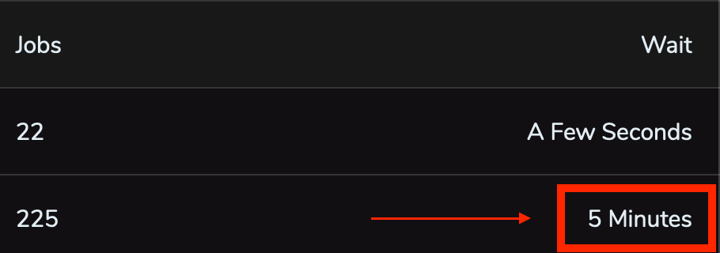
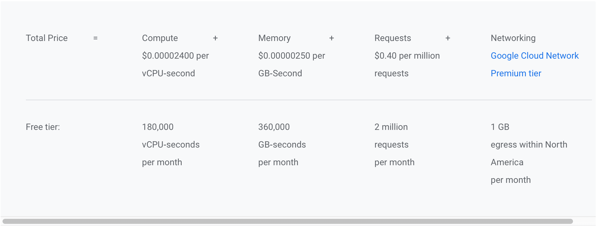
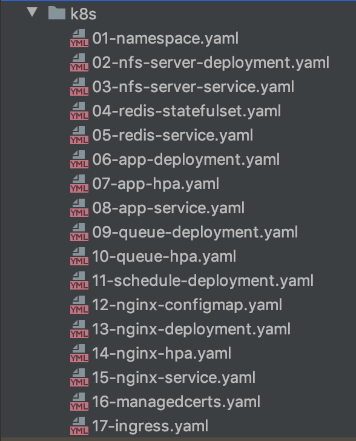
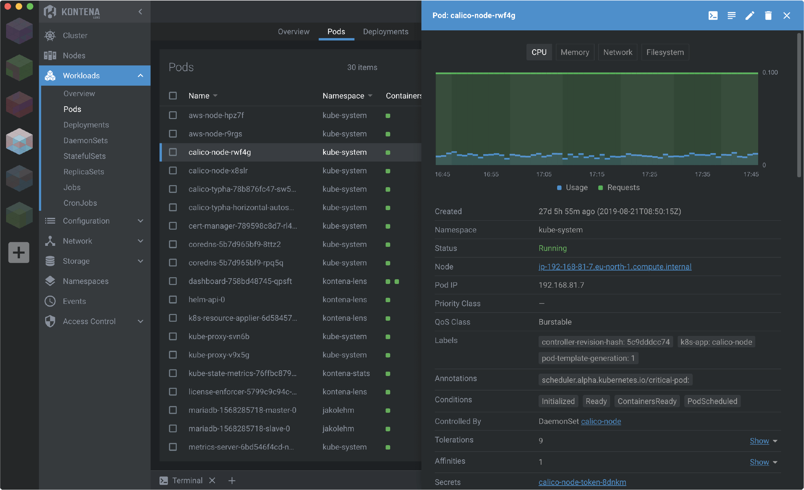
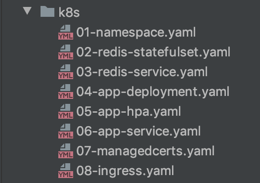

Nesse artigo mostro como preparei múltiplas aplicações para deploy em um único cluster kubernetes e também: o motivo da
escolha do kubernetes, os benefícios, as dificuldades enfrentadas e os próximos passos.

## O problema inicial

Temos pelo menos 5 aplicações principais rodando no [Google Cloud Platform (GCP)](https://cloud.google.com) e também algumas funções que foram desacopladas de uma API e hoje são executadas a partir de [google functions](https://cloud.google.com/functions), acessadas pelas aplicações principais.

Três dessas aplicações principais rodavam individualmente (uma aplicação por VM) em VMs do tipo n1-standard-1 (1vCPU e 3,75GB de RAM). Todas as aplicações containerizadas e o deploy em produção realizado por um simples:

```bash
docker-compose up -d
```

Mesmo com todo o processo de deploy automatizado, sem gerar dores de cabeça, `o desperdício de recursos` por parte de duas aplicações e a `falta de recursos disponíveis` para uma das aplicações me incomodava:

- Uma das aplicações (painel de administração, poucas pessoas com acesso) consumia no máximo 20% da CPU somando
  todos os containers (nginx, app, schedule, queue, redis, certbot) e no máximo 2 dos 3,75GB de RAM.
- Uma segunda aplicação com métricas e situação bem parecida à mencionada acima.
- Uma terceira aplicação, com situação oposta, com métricas recomendando o upgrade da VM para pelo menos 6GB
  de RAM. Essa aplicação executa jobs em queues, pode ficar alguns minutos sem receber nenhum novo job, porém, quando recebe um novo job ela deve executar todos rapidamente, além de poder receber novos jobs enquanto executa o antigo e já ter que iniciar a execução desse novo job sem espera. No framework utilizado nessa aplicação (Laravel), cada worker utiliza pelo menos 32MB de RAM, se configurarmos um valor máximo de 120 workers, já são necessários pelo menos 3840MB de memória RAM, excedendo os 3,75GB de RAM dessa VM. Além do fato de muitas vezes os 120 workers não serem suficientes para uma entrega rápida, ocasionando em um wait time longo para executar os jobs nas queues:



  Essa aplicação definivamente precisava de mais recursos enquanto as outras duas citadas anteriormente não utilizavam todos os recursos disponíveis.

- Uma quarta aplicação, um MVP (_Minimum viable product_) rodando em um único container no [cloud.run](https://cloud.run), já estava validada e precisava evoluir com implementação de queues e cache. Como o cloud.run é feito para conteúdo _stateless_ e não possui acesso a redis (pelo menos não de forma fácil, sem ter que expor o redis de alguma VM por exemplo), era necessário tirá-lo dali.

- Uma quinta aplicação, também em container único, rodava bem no cloud.run e, diferentemente da anterior não precisa de queues. Porém, como possui muitos acessos no cloud.run e o tempo de execução de CPU de cada request dessa aplicação é alto, os custos no cloud.run começaram a incomodar (abaixo os preços do cloud.run com e sem free tier):



Uma solução viável para otimização da utilização de recursos seria executar as aplicações em um cluster, possuindo assim o controle de quanto hardware dedicar a cada aplicação e abrindo possibilidade para escalabilidade da terceira aplicação mencionada anteriormente. Para orquestrar os contâiners no cluster, dentre as opções disponíveis eu teria que escolher bem entre duas: Swarm ou Kubernetes, pois possuía um pouco de conhecimento prévio em ambas as ferramentas.

## Por que Kubernetes?

Gerenciar um cluster é difícil, aplicar patches de segurança, auto reparo, auto upgrade, auto scaling e garantir
disponibilidade são só alguns dos exemplos do que teríamos que manter caso optássemos por gerenciá-lo.

Dentre as opções de cluster citadas anteriormente (Swarm e Kubernetes), nosso cloud provider disponibiliza apenas o serviço de gerenciamento de Kubernetes (na minha opinião, um dos melhores e mais robustos, talvez porque eles projetaram o Kubernetes e a maioria dos seus serviços rodam no mesmo). O serviço é o Google Kubernetes Engine (GKE) e [oferece um plano gratuito para um cluster zonal](https://cloud.google.com/kubernetes-engine#pricing), atendendo nossas necessidades.

Os custos previstos:

- 2 VMs [e2-standard-2](https://cloud.google.com/blog/products/compute/google-compute-engine-gets-new-e2-vm-machine-types) com 2vCPU e 8GB de ram cada, totalizando um cluster com 4vCPU e 16GB de RAM. Com um contrato de [desconto por uso contínuo](https://cloud.google.com/compute/docs/instances/signing-up-committed-use-discounts) de 3 anos, a previsão mensal de custo é de aproximadamente `45 USD`.
- Loadbalancer http/https, 1 até 5 regras de forwarding custam aproximadamente `18 USD`.

Bancos de dados, buckets e outros serviços gerenciados do google não entram na conta pois não foram alterados e seus custos continuaram os mesmos.

## Criando o cluster Kubernetes

Podemos criar o cluster no GKE pelo [Google Cloud Console](https://console.cloud.google.com/kubernetes/) ou via linha de comando a partir de nossa máquina:

> Tenha o gcloud e kubectl previamente instalados.

> Substitua `yourclustername`, `yourprojectname`, `yourregion` (ex para São Paulo: southamerica-east1), `yourregion-zone` (ex para São Paulo e zona a: southamerica-east1-a) e `yournetwork` pelos devidos valores.

```bash
gcloud container \
  clusters create "yourclustername" \
  --project "yourprojectname" \
  --zone "yourregion-zone" \
  --no-enable-basic-auth \
  --release-channel "regular" \
  --machine-type "e2-standard-2" \
  --image-type "COS" \
  --disk-type "pd-ssd" \
  --disk-size "20" \
  --metadata disable-legacy-endpoints=true \
  --scopes "https://www.googleapis.com/auth/devstorage.read_only","https://www.googleapis.com/auth/logging.write","https://www.googleapis.com/auth/monitoring","https://www.googleapis.com/auth/servicecontrol","https://www.googleapis.com/auth/service.management.readonly","https://www.googleapis.com/auth/trace.append" \
  --num-nodes "2" \
  --enable-stackdriver-kubernetes \
  --enable-ip-alias \
  --network "projects/yourprojectname/global/networks/yournetwork" \
  --subnetwork "projects/yourprojectname/regions/yourregion/subnetworks/yournetwork" \
  --default-max-pods-per-node "110" \
  --enable-autoscaling \
  --min-nodes "2" \
  --max-nodes "3" \
  --no-enable-master-authorized-networks \
  --addons HorizontalPodAutoscaling,HttpLoadBalancing,NodeLocalDNS,ApplicationManager \
  --enable-autoupgrade \
  --enable-autorepair \
  --max-surge-upgrade 1 \
  --max-unavailable-upgrade 0 \
  --enable-shielded-nodes
```

Definimos que o cluster terá no mínimo 2 nodes com máquinas do tipo e2-standard-2 (máquinas contratadas no commitment discount mencionado anteriormente), e no máximo 3 nodes.

Altere o contexto do `kubectl` para o GKE:

```bash
kubectl config set-context gke_yourprojectname_yourregion-zone_yourclustername
```

## Preparando os containers

Como dito no primeiro tópico, as aplicações já rodavam containerizadas. Um container dedicado para a aplicação web, um para as queues, um para a execução de schedules, um container redis e um nginx. O container certbot foi descartado pois foi adotada outra abordagem para gerenciamento dos certificados SSL.

Caso você ainda não tenha containerizado sua aplicação, prepare-a de modo que respeite o [Twelve-Factor App](https://12factor.net).

## Preparando os manifestos

Aqui vem o primeiro susto para quem era acostumado a subir o ambiente de produção inteiro com um único arquivo
docker-compose.yaml 🙃



Mostrarei o propósito de cada arquivo. Veja detalhes e conceitos do Kubernetes em sua [documentação](https://kubernetes.io/docs/concepts/).

A infraestrutura da aplicação é definida como código, os controllers do Kubernetes checam em loop `se o estado atual da aplicação é igual ao estado definido via código`, e caso não seja, aplica as modificações necessárias.

Os manifestos podem ser definidos em YAML ou JSON, as extensões `.yaml`, `.yml` e `.json` são aceitas. Coloco todos no mesmo diretório para facilitar o deploy com o comando:

```bash
kubectl apply -f k8s/
```

###### 01-namespace.yaml

```yaml
apiVersion: v1
kind: Namespace
metadata:
  name: yourapp1
  labels:
    name: yourapp1

---
apiVersion: v1
kind: ResourceQuota
metadata:
  name: resource-quota
  namespace: yourapp1
spec:
  hard:
    requests.cpu: 300m
    requests.memory: 1536Mi
    limits.cpu: 500m
    limits.memory: 2048Mi
```

Nesse arquivo defino o [Namespace](https://kubernetes.io/docs/concepts/overview/working-with-objects/namespaces/) da aplicação. Com namespaces é possível definir o escopo das aplicações. Assim é possível executar várias aplicações diferentes no mesmo cluster sem que interfiram uma na outra (a comunicação entre namespaces ainda é possível através de serviços expostos como mostrarei). Outra utilidade de namespaces é separar ambientes de `staging` e `production` por exemplo. Por padrão, caso namespaces não sejam definidos os deploys são realizados no namespace `default`.

No mesmo arquivo defino um deploy do tipo [Resource Quota](https://kubernetes.io/docs/concepts/policy/resource-quotas/), nele é possível definir os recursos e limites de recursos solicitados pelo namespace. No exemplo, defino que:

- `requests.cpu: 300m` - todos os componentes do namespace somados podem requisitar (somados) no máximo 300 millicores de cpu (1vCPU = 1000m, valores de cpu podem ser definidos a partir de 1m).

- `requests.memory: 1536Mi` - todos os componentes do namespace somados podem requisitar (somados) no máximo 1536Mi de memória (1 Mebibyte (MiB) = (1024)^2 bytes = 1048576 bytes).

- `limits.cpu: 500m` - todos os componentes do namespace somados (apesar de poderem requisitar 300m de cpu definidos anteriormente) podem utilizar o máximo 500 millicores de cpu.

- `limits.memory: 2048Mi` - todos os componentes do namespace somados (apesar de poderem requisitar 1536Mi de memória definidos anteriormente) podem utilizar no máximo 2048Mi de memória.

Quando os limites de cpu definidos são atingidos, a aplicação começa a sofrer `throttled` de cpu, ou seja, sua performance é afetada.

Quando os limites de memória são atingidos, não é possível "comprimir" a memória como é feito com cpu, e seu [Pod](https://kubernetes.io/docs/concepts/workloads/pods/pod-overview/) é terminado.

Quando um deploy de uma nova versão da sua aplicação é feita, caso o limite de cpu ou memória seja excedido, os pods não serão executados e ficarão com o estado [Evicted](https://kubernetes.io/docs/tasks/administer-cluster/out-of-resource/#eviction-policy).

A definição de ResourceQuota para um namespace é opcional, porém garante que uma aplicação não consuma recursos demasiadamente.

###### 02-nfs-server-deployment.yaml

```yaml
apiVersion: apps/v1
kind: Deployment
metadata:
  name: nfs-server
  namespace: yourapp1
spec:
  replicas: 1
  selector:
    matchLabels:
      name: nfs-server
  template:
    metadata:
      labels:
        name: nfs-server
    spec:
      containers:
        - name: nfs-server
          image: gcr.io/google_containers/volume-nfs:latest
          ports:
            - name: nfs
              containerPort: 2049
            - name: mountd
              containerPort: 20048
            - name: rpcbind
              containerPort: 111
          securityContext:
            privileged: true
          resources:
            requests:
              cpu: 1m
              memory: 168Mi
            limits:
              cpu: 2m
              memory: 192Mi
          volumeMounts:
            - name: data
              mountPath: /exports

      volumes:
        - name: data
          gcePersistentDisk:
            pdName: yourapp1-nfs-disk
            fsType: ext4
```

Nesse arquivo defino o deployment de um volume NFS, já que o padrão [GCEPersistentDisk](https://kubernetes.io/docs/concepts/storage/persistent-volumes/#access-modes) do GKE não suporta o tipo de acesso `ReadWriteMany` para ser lido e escrito por vários nodes ao mesmo tempo.

Este volume será usado para persistir os dados do redis e também as páginas estáticas que são geradas a partir do container app e compartilhadas com o container nginx.

Alguns detalhes do arquivo:

- O namespace deve ser o mesmo definido anteriormente para que o escopo do deploy seja o mesmo namespace.
- Ele possui apenas uma réplica.
- As requests e limits de cpu desse deployment podem ser bem pequenas (mostro mais a frente como analisar).
- O volume é montado no path /exports do disco.
- O disco definido em `pdName` nos volumes deve ser criado anteriormente com:

```bash
gcloud compute disks create --size=1GB --zone=yourregion-zone --type=pd-ssd yourapp1-nfs-disk
```

###### 03-nfs-server-service.yaml

```yaml
apiVersion: v1
kind: Service
metadata:
  name: nfs-server
  namespace: yourapp1
spec:
  ports:
    - name: nfs
      port: 2049
    - name: mountd
      port: 20048
    - name: rpcbind
      port: 111
  selector:
    name: nfs-server
```

O service acima é o responsável por [expor o deployment criado anteriormente para ser acessado pelos outros pods](https://kubernetes.io/docs/concepts/services-networking/service/). O serviço é exposto com ClusterIp, apenas para outros pods, e não para a internet.

Lembre-se de definir o `selector` do service com o mesmo valor definido nas `labels` do selector no deployment.

###### 04-redis-statefulset.yaml

```yaml
apiVersion: apps/v1
kind: StatefulSet
metadata:
  name: redis
  namespace: yourapp1
spec:
  serviceName: redis
  selector:
    matchLabels:
      name: redis
  template:
    metadata:
      name: redis
      labels:
        name: redis
    spec:
      containers:
        - name: redis
          image: redis:5.0.5-alpine
          ports:
            - containerPort: 6379
          resources:
            requests:
              cpu: 5m
              memory: 14Mi
            limits:
              cpu: 5m
              memory: 16Mi
          volumeMounts:
            - name: data
              mountPath: /data
      volumes:
        - name: data
          nfs:
            server: nfs-server.yourapp1.svc.cluster.local
            path: "/redis/data"
```

O deploy do redis é do tipo [StatefulSet](https://kubernetes.io/docs/concepts/workloads/controllers/statefulset/), o volume pode acessar diretamente o serviço deployado anteriormente via `<service>`.`<namespace>`.svc.cluster.local.

###### 05-redis-service.yaml

```yaml
apiVersion: v1
kind: Service
metadata:
  name: redis
  namespace: yourapp1
spec:
  ports:
    - port: 6379
      protocol: TCP
  selector:
    name: redis
```

Expõe o redis com ClusterIp para ser acessado pelos outros pods.

###### 06-app-deployment.yaml

```yaml
apiVersion: apps/v1
kind: Deployment
metadata:
  name: app
  namespace: yourapp1
  labels:
    name: app
  annotations:
    secret.reloader.stakater.com/reload: "env"
spec:
  replicas: 2
  revisionHistoryLimit: 1
  selector:
    matchLabels:
      name: app
  strategy:
    type: RollingUpdate
    rollingUpdate:
      maxSurge: 1
      maxUnavailable: 50%
  template:
    metadata:
      labels:
        name: app
    spec:
      containers:
        - name: app
          image: gcr.io/yourproject/yourapp1:TAG_NAME
          command: ["/bin/bash"]
          args:
            - -c
            - |
              sleep 12
              php artisan migrate --force
              php artisan optimize
              php artisan view:cache
              ln -s public html
              ln -s /var/www /usr/share/nginx
              /usr/local/sbin/php-fpm
          envFrom:
            - secretRef:
                name: env
          readinessProbe:
            initialDelaySeconds: 20
            periodSeconds: 10
            timeoutSeconds: 5
            failureThreshold: 3
            successThreshold: 1
            tcpSocket:
              port: 9000
          ports:
            - containerPort: 9000
          resources:
            requests:
              cpu: 20m
              memory: 320Mi
            limits:
              cpu: 50m
              memory: 512Mi
          volumeMounts:
            - name: static
              mountPath: /static
            - name: cache-html
              mountPath: /var/www/public/cache-html
          lifecycle:
            postStart:
              exec:
                command: ["/bin/bash", "-c", "cp -r /var/www/public/. /static"]

        - name: cloudsql-proxy
          image: gcr.io/cloudsql-docker/gce-proxy:latest
          command:
            [
              "/cloud_sql_proxy",
              "-instances=yourproject:cloudsql-region:yourproject=tcp:5432",
              "-credential_file=/secrets/cloudsql/cloudsqlproxy.json",
            ]
          resources:
            requests:
              cpu: 1m
              memory: 8Mi
            limits:
              cpu: 10m
              memory: 16Mi
          volumeMounts:
            - name: cloudsql-instance-credentials
              mountPath: /secrets/cloudsql
              readOnly: true

      volumes:
        - name: static
          nfs:
            server: nfs-server.yourapp1.svc.cluster.local
            path: "/static"
        - name: cache-html
          nfs:
            server: nfs-server.yourapp1.svc.cluster.local
            path: "/cache-html"
        - name: cloudsql-instance-credentials
          secret:
            secretName: cloudsql-instance-credentials
```

Responsável pelo deploy da aplicação laravel com fpm, em `annotations` temos uma anotação `secret.reloader.stakater.com/reload: "env"` que irá realizar o deploy de um novo pod `sempre que a secret com nome env` for atualizada. Esse comportamento não é padrão do kubernetes e para habilitá-lo instalamos um controller chamado [Reloader](https://github.com/stakater/Reloader) com o comando:

```bash
kubectl apply -f https://raw.githubusercontent.com/stakater/Reloader/master/deployments/kubernetes/reloader.yaml
```

- `replicas: 2` - definimos que o deploy irá criar 2 pods.
- `revisionHistoryLimit: 1` - só teremos acesso a uma versão anterior a atual para rollback.

Em `strategy`:

- `type: RollingUpdate` - Nosso deploy é do tipo [Rolling Update](https://kubernetes.io/docs/concepts/workloads/controllers/deployment/#rolling-update-deployment).
- `maxSurge: 1` - Só pode surgir um novo pod por vez.
- `maxUnavailable: 50%` - No mínimo metade dos pods devem estar disponíveis durante o deploy, ou seja, no exemplo com `replicas: 2` e `maxSurge: 1`, um novo pod surgirá, então um pod antigo será terminado (respeitando o `maxUnavailable: 50%`), então um novo pod surgirá, e o último pod antigo será terminado.

Em `containers`:

Esse pod possui 2 containers, o app principal e um sidecar (um proxy para conexão com o banco de dados no Google Cloud SQL).

No primeiro container `app` temos:

- `commands:` e `args:` - são os comandos que serão executados pelo nosso container, o `sleep` inicial serve para aguardar até que o container sidecar esteja disponível. Na versão `1.18` em diante [esse sleep não será mais necessário](https://banzaicloud.com/blog/k8s-sidecars/).
- `envFrom:` - injetamos nossas variáveis de ambiente (mostrarei como criá-las no tópico [Automatizando o processo de teste e deploy com um pipeline CI/CD](#automatizando-o-processo-de-testes-e-deploy-com-um-pipeline-de-cicd)).
- `readinessProbe:` - O container só receberá tráfego após uma conexão TCP bem sucedida com o container na porta 9000.
- `volumeMounts:` - O volume static compartilha assets entre o app e o nginx. O volume cache-html armazena algumas páginas de forma estática geradas a partir do conteúdo dinâmico, evitando a renderização a todo momento.

No sidecar container `cloudsql-proxy` fazemos a autenticação com o uso de um secret que também mostro como criá-la no tópico [Automatizando o processo de teste e deploy com um pipeline CI/CD](#automatizando-o-processo-de-testes-e-deploy-com-um-pipeline-de-cicd).

###### 07-app-hpa.yaml

```yaml
apiVersion: autoscaling/v2beta1
kind: HorizontalPodAutoscaler
metadata:
  name: app
  namespace: yourapp1
spec:
  maxReplicas: 3
  minReplicas: 1
  scaleTargetRef:
    apiVersion: apps/v1
    kind: Deployment
    name: app
  metrics:
    - type: Resource
      resource:
        name: cpu
        targetAverageUtilization: 90
    - type: Resource
      resource:
        name: memory
        targetAverageUtilization: 90
```

O [Horizontal Pod Autoscaler (HPA)](https://kubernetes.io/docs/tasks/run-application/horizontal-pod-autoscale/) escala automaticamente o número de pods do nosso deployment. No exemplo em [06-app-deployment.yaml](06-app-deploymentyaml), nosso deployment foi feito com duas réplicas, o HPA acima irá escalar esse deployment para 1 ou 3 réplicas baseado na média de utilização de cpu e memória do deployment.

###### 08-app-service.yaml

```yaml
apiVersion: v1
kind: Service
metadata:
  name: app
  namespace: yourapp1
  labels:
    name: app
spec:
  ports:
    - protocol: TCP
      port: 9000
  selector:
    name: app
```

Expõe o app com ClusterIp para ser acessado pelos outros pods.

###### 09-queue-deployment.yaml

```yaml
apiVersion: apps/v1
kind: Deployment
metadata:
  name: queue
  namespace: yourapp1
  labels:
    name: queue
  annotations:
    secret.reloader.stakater.com/reload: "env"
spec:
  replicas: 1
  revisionHistoryLimit: 1
  selector:
    matchLabels:
      name: queue
  strategy:
    type: RollingUpdate
    rollingUpdate:
      maxSurge: 1
      maxUnavailable: 50%
  template:
    metadata:
      labels:
        name: queue
    spec:
      containers:
        - name: queue
          image: gcr.io/yourproject/yourapp1:TAG_NAME
          command: ["/bin/bash"]
          args:
            - -c
            - |
              php artisan config:cache
              php artisan horizon --quiet
          envFrom:
            - secretRef:
                name: env
          resources:
            requests:
              cpu: 100m
              memory: 128Mi
            limits:
              cpu: 150m
              memory: 512Mi

        - name: cloudsql-proxy
          image: gcr.io/cloudsql-docker/gce-proxy:latest
          command:
            [
              "/cloud_sql_proxy",
              "-instances=yourproject:cloudsql-region:yourproject=tcp:5432",
              "-credential_file=/secrets/cloudsql/cloudsqlproxy.json",
            ]
          resources:
            requests:
              cpu: 1m
              memory: 8Mi
            limits:
              cpu: 10m
              memory: 16Mi
          volumeMounts:
            - name: cloudsql-instance-credentials
              mountPath: /secrets/cloudsql
              readOnly: true

      volumes:
        - name: cloudsql-instance-credentials
          secret:
            secretName: cloudsql-instance-credentials
```

Os conceitos são os mesmos do [06-app-deployment.yaml](#06-app-deploymentyaml), porém iniciamos com apenas uma réplica e o HPA a seguir controla a necessidade de outras réplicas.

###### 10-queue-hpa.yaml

```yaml
apiVersion: autoscaling/v2beta1
kind: HorizontalPodAutoscaler
metadata:
  name: queue
  namespace: yourapp1
spec:
  maxReplicas: 2
  minReplicas: 1
  scaleTargetRef:
    apiVersion: apps/v1
    kind: Deployment
    name: queue
  metrics:
    - type: Resource
      resource:
        name: cpu
        targetAverageUtilization: 100
    - type: Resource
      resource:
        name: memory
        targetAverageUtilization: 90
```

Os conceitos são os mesmos do [07-app-hpa.yaml](#07-app-hpayaml), porém para a queue.

###### 11-schedule-deployment.yaml

```yaml
apiVersion: apps/v1
kind: Deployment
metadata:
  name: schedule
  namespace: yourapp1
  labels:
    name: schedule
  annotations:
    secret.reloader.stakater.com/reload: "env"
spec:
  replicas: 1
  revisionHistoryLimit: 1
  selector:
    matchLabels:
      name: schedule
  template:
    metadata:
      labels:
        name: schedule
    spec:
      containers:
        - name: schedule
          image: gcr.io/yourproject/yourapp1:TAG_NAME
          command: ["/bin/bash"]
          args:
            - -c
            - |
              php artisan config:cache
              chmod +x schedule.sh
              /var/www/schedule.sh
          envFrom:
            - secretRef:
                name: env
          resources:
            requests:
              cpu: 10m
              memory: 8Mi
            limits:
              cpu: 30m
              memory: 64Mi

        - name: cloudsql-proxy
          image: gcr.io/cloudsql-docker/gce-proxy:latest
          command:
            [
              "/cloud_sql_proxy",
              "-instances=yourproject:cloudsql-region:yourproject=tcp:5432",
              "-credential_file=/secrets/cloudsql/cloudsqlproxy.json",
            ]
          resources:
            requests:
              cpu: 1m
              memory: 8Mi
            limits:
              cpu: 15m
              memory: 16Mi
          volumeMounts:
            - name: cloudsql-instance-credentials
              mountPath: /secrets/cloudsql
              readOnly: true

      volumes:
        - name: cloudsql-instance-credentials
          secret:
            secretName: cloudsql-instance-credentials
```

Se você já usa kubernetes provavelmente pensou "existe um controller [CronJob](https://kubernetes.io/docs/concepts/workloads/controllers/cron-jobs/) para isso". Sim, porém meus crons são executados a cada minuto, o processo de um controller disparar um job, subir um pod, executar o container, matar o pod, e repetir de novo alguns segundos depois não me parece legal. [Não sou o único a adotar essa abordagem para conjobs a cada minuto](https://youtu.be/MoIdU0J0f0E?t=939).

###### 12-nginx-configmap.yaml

```yaml
apiVersion: v1
kind: ConfigMap
metadata:
  name: nginx-configmap
  namespace: yourapp1
data:
  nginx.conf: |
    user  nginx;
    worker_processes  auto;

    events {
      worker_connections 4096;
      multi_accept on;
      use epoll;
    }

    http {
      include       mime.types;
      server_tokens off;
      default_type  application/octet-stream;

      client_body_buffer_size 10K;
      client_header_buffer_size 1k;
      client_max_body_size 10m;
      large_client_header_buffers 4 16k;

      access_log off;
      error_log /dev/stderr;

      sendfile on;

      keepalive_timeout  65;
      keepalive_requests 100;

      log_format json_combined escape=json
        '{'
          '"time_local":"$time_local",'
          '"remote_addr":"$remote_addr",'
          '"remote_user":"$remote_user",'
          '"request":"$request",'
          '"status": "$status",'
          '"body_bytes_sent":"$body_bytes_sent",'
          '"request_time":"$request_time",'
          '"http_referrer":"$http_referer",'
          '"http_user_agent":"$http_user_agent"'
        '}';

      server {
        listen 80;
        server_name yourapp1.com www.yourapp1.com;
        index index.php index.html;
        root /usr/share/nginx/html;

        if ($host = "www.yourapp1.com") {
          rewrite ^ https://yourapp1.com$request_uri? permanent;
        }

        if ($http_x_forwarded_proto = "http") {
          rewrite ^ https://yourapp1.com$request_uri? permanent;
        }

        add_header 'Referrer-Policy' 'same-origin';
        add_header 'Feature-Policy' "geolocation 'none'; vibrate 'none'";
        add_header 'Strict-Transport-Security' 'max-age=31536000; includeSubdomains; preload';
        add_header 'X-Content-Type-Options' 'nosniff';
        add_header 'X-Frame-Options' 'SAMEORIGIN';
        add_header 'X-XSS-Protection' '1; mode=block';

        gzip on;
        gzip_disable "MSIE [1-6]\.(?!.*SV1)";
        gzip_vary on;
        gzip_proxied any;
        gzip_comp_level 6;
        gzip_buffers 16 8k;
        gzip_http_version 1.1;
        gzip_types text/plain text/css application/json application/x-javascript text/xml application/xml application/xml+rss text/javascript application/javascript text/x-js;

        location ~* \.(js|jpg|jpeg|gif|png|css|tgz|gz|rar|bz2|doc|pdf|ppt|tar|wav|bmp|rtf|swf|ico|flv|txt|woff|woff2|svg|xml)$ {
          root /static;
          expires 365d;
          access_log off;
          etag on;
          if_modified_since exact;
          add_header Pragma "public";
          add_header Cache-Control "max-age=31536000, public";
          add_header Access-Control-Allow-Origin *;
          try_files $uri =404;
        }

        location = / {
          try_files /cache-html/index.html /index.php?$args;
        }

        location ~ ^/(comprar|blog|recompensas|avaliacoes-de-clientes|termos-de-servico|sobre-nos|politica-de-privacidade|politica-de-cancelamento).*$ {
          try_files /cache-html/$uri.html$arg_page $uri $uri/ /index.php?$args;
        }

        location / {
          try_files $uri $uri/ /index.php?$query_string;
        }

        location ~ \.php$ {
          try_files $uri =404;
          fastcgi_split_path_info ^(.+\.php)(/.+)$;
          fastcgi_pass app:9000;
          fastcgi_index index.php;
          include fastcgi_params;
          fastcgi_param SCRIPT_FILENAME $document_root$fastcgi_script_name;
          fastcgi_param PATH_INFO $fastcgi_path_info;
          fastcgi_read_timeout 180;
          proxy_set_header Host            $http_host;
          proxy_set_header X-Real-IP       $remote_addr;
          proxy_set_header X-Forwarded-For $proxy_add_x_forwarded_for;
        }
      }
    }
```

O [ConfigMap](https://kubernetes.io/docs/tasks/configure-pod-container/configure-pod-configmap/) com a configuração nginx utilizada para essa aplicação.

###### 13-nginx-deployment.yaml

```yaml
apiVersion: apps/v1
kind: Deployment
metadata:
  name: nginx
  namespace: yourapp1
  annotations:
    configmap.reloader.stakater.com/reload: "nginx-configmap"
spec:
  replicas: 1
  selector:
    matchLabels:
      name: nginx
  template:
    metadata:
      labels:
        name: nginx
    spec:
      containers:
        - name: nginx
          image: nginx:1.17-alpine
          command:
            [
              "/bin/sh",
              "-c",
              "touch /usr/share/nginx/html/index.php; nginx -g 'daemon off;'",
            ]
          resources:
            requests:
              cpu: 1m
              memory: 16Mi
            limits:
              cpu: 2m
              memory: 32Mi
          ports:
            - containerPort: 80
          volumeMounts:
            - name: nginx-configmap
              mountPath: /etc/nginx/nginx.conf
              subPath: nginx.conf
              readOnly: true
            - name: static
              mountPath: /static
            - name: cache-html
              mountPath: /usr/share/nginx/html/cache-html

      volumes:
        - name: nginx-configmap
          configMap:
            name: nginx-configmap
            items:
              - key: nginx.conf
                path: nginx.conf
        - name: static
          nfs:
            server: nfs-server.yourapp1.svc.cluster.local
            path: "/static"
        - name: cache-html
          nfs:
            server: nfs-server.yourapp1.svc.cluster.local
            path: "/cache-html"
```

O deployment do nginx utiliza o nfs-server criado no [passo 2](#02-nfs-server-deploymentyaml) e exposto no [passo 3](#02-nfs-server-serviceyaml), ele terá acesso aos conteúdos compartilhados pelo [passo 6](#06-app-deploymentyaml). Além de utilizar o nginx-configmap criado no passo anterior.

###### 14-nginx-hpa.yaml

```yaml
apiVersion: autoscaling/v2beta1
kind: HorizontalPodAutoscaler
metadata:
  name: nginx
  namespace: yourapp1
spec:
  maxReplicas: 2
  minReplicas: 1
  scaleTargetRef:
    apiVersion: apps/v1
    kind: Deployment
    name: nginx
  metrics:
    - type: Resource
      resource:
        name: cpu
        targetAverageUtilization: 90
    - type: Resource
      resource:
        name: memory
        targetAverageUtilization: 90
```

Os conceitos são os mesmos do [07-app-hpa.yaml](#07-app-hpayaml), porém para o nginx.

###### 15-nginx-service.yaml

```yaml
apiVersion: v1
kind: Service
metadata:
  name: nginx
  namespace: yourapp1
spec:
  type: NodePort
  ports:
    - port: 80
      targetPort: 80
  selector:
    name: nginx
```

Expõe o nginx com o tipo NodePort para que seja acessado pela internet.

###### 16-managedcerts.yaml

```yaml
apiVersion: networking.gke.io/v1beta1
kind: ManagedCertificate
metadata:
  name: yourapp1-com
  namespace: yourapp1
spec:
  domains:
    - yourapp1.com

---
apiVersion: networking.gke.io/v1beta1
kind: ManagedCertificate
metadata:
  name: www-yourapp-com
  namespace: yourapp1
spec:
  domains:
    - www.yourapp1.com
```

Os certificados SSL auto gerenciados pelo Google. Mais detalhes no tópico [Adicionando certificados SSL auto gerenciados](#adicionando-certificados-ssl-auto-gerenciados)

###### 17-ingress.yaml

```yaml
apiVersion: networking.k8s.io/v1beta1
kind: Ingress
metadata:
  name: nginx
  namespace: yourapp1
  annotations:
    kubernetes.io/ingress.global-static-ip-name: yourapp1-global-ip-name
    networking.gke.io/managed-certificates: yourapp1-com,www-yourapp1-com
spec:
  backend:
    serviceName: nginx
    servicePort: 80
```

Criaremos um ip global para ser utilizado pela aplicação:

```bash
gcloud compute addresses create yourapp1-global-ip-name --global
```

O ingress irá expor a aplicação para a internet. Em `annotations` adicionamos o nome do IP global criado acima e o nome dos certificados gerenciados criados no passo anterior. Em `spec` definimos que todas as requests serão encaminhadas para o serviço nginx na porta 80, criado em [15-nginx-service.yaml](#15-nginx-serviceyaml).

Por trás dos panos, um load balancer é criado com duas forwarding rules (http e https) apontando para esse ingress e sua `spec`.

## Adicionando certificados SSL auto gerenciados

Crie uma zona DNS

https://cloud.google.com/dns/docs/

Aponte o NS em seu register domain para os mostrados na zona DNS criada acima.

Aponte o record A para o IP criado anteriormente em [17-ingress.yaml](#17-ingressyaml). Obtenha o IP com o comando:

```bash
gcloud compute addresses \
  describe yourapp1-global-ip-name --global \
  --format='value(address)'
```

Veja com o comando `host yourapp1.com` se ele já está apontando para o IP criado anteriormente.

No processo de deploy, quando o arquivo [16-managedcerts.yaml](#16-managedcertsyaml) for aplicado (`kubectl apply -f 16-managedcerts.yaml`), o processo de geração do certificado irá levar de 15 a 30 minutos.

## Realizando o deploy dos manifestos

O deploy pode ser realizado por arquivo:

```bash
kubectl apply -f 01-namespace.yaml
kubectl apply -f 02-nfs-server-deployment.yaml
```

Ou todos os arquivos da pasta

```bash
kubectl apply -f k8s/
```

O mesmo se aplica para o delete com o `kubectl delete`.

## Automatizando o processo de testes e deploy com um pipeline de CI/CD

O [Google KMS](https://cloud.google.com/kms) é um serviço quer permite gerenciar chaves criptográficas. Com ele podemos criptografar arquivos de configuração/environment variables e `até adicioná-los ao controle de versão` de forma segura, pois estarão criptografados.

Após [ativar a API do KMS](https://console.developers.google.com/apis/library/cloudkms.googleapis.com), crie um grupo de chaves:

```bash
gcloud kms keyrings create yourkeyringname --location global
```

Crie uma chave:

```bash
gcloud kms keys create yourkeyname --location global --keyring yourkeyringname --purpose encryption
```

Criptografe os arquivos de configuração/environment variables que deseja:

```bash
gcloud kms encrypt --location global \
  --keyring yourkeyringname --key yourkeyname \
  --plaintext-file .env.prod \
  --ciphertext-file .env.prod.enc
```

```bash
gcloud kms encrypt --location global \
  --keyring yourkeyringname --key yourkeyname \
  --plaintext-file cloudsqlproxy.json \
  --ciphertext-file cloudsqlproxy.json.enc
```

> O exemplo abaixo é necessário apenas se possui algum pacote privado como o [Laravel Nova](https://nova.laravel.com).

```bash
gcloud kms encrypt --location global \
  --keyring yourkeyringname --key yourkeyname \
  --plaintext-file auth.json \
  --ciphertext-file auth.json.enc
```

Agora ambos podem ser commitados de forma segura :)

Utilizo o [Cloud Build](https://cloud.google.com/cloud-build/) para o processo de CI/CD, separo os processos em duas [triggers](https://console.cloud.google.com/cloud-build/triggers) e dois arquivos: `cloudbuild.ci.yaml` e `cloudbuild.cd.yaml`. Lembre-se de adicionar as `variáveis de substituição` nas triggers criadas no Cloud Build:

- `_CLUSTER` - o nome do seu cluster
- `_KEY` - sua chave kms criada anteriormente
- `_KEYRING` - seu keyring criado anteriormente
- `_ZONE` - yourregion-zone

###### cloudbuild.ci.yaml

```yaml
steps:
  - id: "Decrypt auth.json"
    name: gcr.io/cloud-builders/gcloud
    args:
      - kms
      - decrypt
      - --ciphertext-file=auth.json.enc
      - --plaintext-file=auth.json
      - --location=global
      - --keyring=$_KEYRING
      - --key=$_KEY

  - id: "Copy .env file"
    name: gcr.io/cloud-builders/gsutil
    args: ["cp", ".env.testing", ".env"]

  - id: "Up"
    name: docker/compose:1.24.0
    args: ["-f", "docker-compose.testing.yml", "up", "-d", "app"]

  - id: "Install dependencies"
    name: gcr.io/cloud-builders/docker
    args:
      [
        "exec",
        "-t",
        "app",
        "composer",
        "install",
        "--no-interaction",
        "--no-ansi",
        "--no-progress",
        "--prefer-dist",
        "--optimize-autoloader",
      ]

  - id: "Duplicated code analysis"
    name: gcr.io/cloud-builders/docker
    waitFor: ["Install dependencies"]
    args: ["exec", "-t", "app", "composer", "phpcpd"]

  - id: "Lint analysis"
    name: gcr.io/cloud-builders/docker
    waitFor: ["Install dependencies"]
    args: ["exec", "-t", "app", "composer", "lint"]

  - id: "Code quality and code style analysis"
    name: gcr.io/cloud-builders/docker
    waitFor: ["Install dependencies"]
    args: ["exec", "-t", "app", "composer", "insights"]

  - id: "Run tests"
    name: gcr.io/cloud-builders/docker
    waitFor: ["Install dependencies"]
    args: ["exec", "-t", "app", "composer", "test"]
```

###### cloudbuild.cd.yaml

```yaml
steps:
  - id: "Decrypt .env"
    name: gcr.io/cloud-builders/gcloud
    args:
      - kms
      - decrypt
      - --ciphertext-file=.env.prod.enc
      - --plaintext-file=.env
      - --location=global
      - --keyring=$_KEYRING
      - --key=$_KEY

  - id: "Decrypt cloudsqlproxy.json service account"
    name: gcr.io/cloud-builders/gcloud
    args:
      - kms
      - decrypt
      - --ciphertext-file=cloudsqlproxy.json.enc
      - --plaintext-file=cloudsqlproxy.json
      - --location=global
      - --keyring=$_KEYRING
      - --key=$_KEY

  - id: "Decrypt auth.json"
    name: gcr.io/cloud-builders/gcloud
    args:
      - kms
      - decrypt
      - --ciphertext-file=auth.json.enc
      - --plaintext-file=auth.json
      - --location=global
      - --keyring=$_KEYRING
      - --key=$_KEY

  - id: "Create env secret manifest"
    name: gcr.io/cloud-builders/kubectl
    waitFor: ["Decrypt .env"]
    entrypoint: /bin/sh
    args:
      - -c
        - |
        kubectl create secret generic env --from-env-file .env --dry-run -n yourapp1 -o yaml > k8s/06.0-app-secret.yaml
    env:
      - "CLOUDSDK_COMPUTE_ZONE=$_ZONE"
      - "CLOUDSDK_CONTAINER_CLUSTER=$_CLUSTER"

  - id: "Create cloudsqlproxy secret manifest"
    name: gcr.io/cloud-builders/kubectl
    waitFor: ["Decrypt cloudsqlproxy.json service account"]
    entrypoint: /bin/sh
    args:
      - -c
      - |
        kubectl create secret generic cloudsql-instance-credentials --from-file=cloudsqlproxy.json=./cloudsqlproxy.json --dry-run -n yourapp1 -o yaml > k8s/06.1-cloudsqlproxy.yaml
    env:
      - "CLOUDSDK_COMPUTE_ZONE=$_ZONE"
      - "CLOUDSDK_CONTAINER_CLUSTER=$_CLUSTER"

  - id: "Build docker image"
    name: gcr.io/cloud-builders/docker
    args:
      [
        "build",
        "--build-arg",
        "COMPOSER_FLAGS=--prefer-dist --classmap-authoritative --no-dev",
        "-t",
        "gcr.io/$PROJECT_ID/yourapp1:$TAG_NAME",
        "-t",
        "gcr.io/$PROJECT_ID/yourapp1:latest",
        ".",
      ]

  - id: "Push docker image"
    name: gcr.io/cloud-builders/docker
    args: ["push", "gcr.io/$PROJECT_ID/yourapp1"]

  - id: "Set manifests image TAG_NAME"
    name: gcr.io/cloud-builders/gcloud
    entrypoint: /bin/sh
    args:
      - "-c"
      - |
        sed -i 's/TAG_NAME/$TAG_NAME/g' k8s/06-app-deployment.yaml
        sed -i 's/TAG_NAME/$TAG_NAME/g' k8s/09-queue-deployment.yaml
        sed -i 's/TAG_NAME/$TAG_NAME/g' k8s/11-schedule-deployment.yaml

  - id: "Deploy"
    name: gcr.io/cloud-builders/gke-deploy
    args:
      ["apply", "-f", "k8s/", "--cluster", "$_CLUSTER", "--location", "$_ZONE"]

  - id: "Copy assets to bucket"
    name: gcr.io/cloud-builders/gsutil
    waitFor: ["-"]
    args:
      [
        "-h",
        "Cache-Control:public,max-age=31536000",
        "-m",
        "cp",
        "-r",
        "-Z",
        "public/*",
        "gs://yourapp1bucket",
      ]
```

Não vou entrar em detalhes sobre o processo de CI em `cloudbuild.ci.yaml` pois não é o propósito. Em resumo sobre o processo de CD em `cloudbuild.cd.yaml`:

- Os arquivos de configuração/environment variables são descriptografados.
- A criação secret `env` utilizada nos manifestos de `06-app-deployment`, `09-queue-deployment` e `11-schedule-deployment` é simulada com `--dry-run` a partir do arquivo .env que foi descriptografado e seu output é salvo em `k8s/06.0-app-secret.yaml`.
- O mesmo processo ser repete para a service account utilizada para que o cloudsqlproxy tenha acesso ao Cloud SQL.
- A imagem docker é criada e tageada com a release tag do repositório e também com a tag latest.
- A palavra TAG_NAME é substituída pela release tag do repositório nos arquivos de manifesto.
- O deploy dos manifestos é realizado.
- Os assets da aplicação são copiados para um bucket.

> Dica: Caso queira que um commit não passe pelo processo de CI/CD, adicione `[skip cd]` à mensagem de commit.

## Monitorando o cluster com Kontena Lens e métricas Prometheus

Usando a api do kubernetes é possível obter vários dados para monitorar o cluster, porém para uma visão gráfica geral de todos os namespaces utilizo o [Kontena Lens](https://k8slens.dev), uma ferramenta grátis e opensource:



Após instalá-lo e conectá-lo ao cluster, clique com o botão direito no ícone do cluster e habilite as métricas prometheus.

Analise ao longo do tempo se as `requests` e os `limits` definidos nos deployments estão sendo suficientes ou até mesmo se estão desperdiçando recurso e redefina-os caso necessário.

## Realizando o deploy de outras aplicações

O processo de deploy das outras aplicações é o mesmo, o namespace é diferente, mas os conceitos são os mesmos. Como um rápido exemplo, a quinta aplicação mencionada no início (executada no cloud.run), desta vez com um container apache:

<p align="center">
  
</p>

Exemplo do app-deployment:

```yaml
apiVersion: apps/v1
kind: Deployment
metadata:
  name: app
  namespace: yourapp2
  labels:
    name: app
  annotations:
    secret.reloader.stakater.com/reload: "env"
spec:
  replicas: 1
  revisionHistoryLimit: 1
  selector:
    matchLabels:
      name: app
  strategy:
    type: RollingUpdate
    rollingUpdate:
      maxSurge: 1
      maxUnavailable: 50%
  template:
    metadata:
      labels:
        name: app
    spec:
      containers:
        - name: app
          image: gcr.io/yourproject/yourapp2:TAG_NAME
          command: ["/bin/bash"]
          args:
            - -c
            - |
              php artisan optimize
              php artisan view:cache
              apache2-foreground
          envFrom:
            - secretRef:
                name: env
          ports:
            - containerPort: 8080
          resources:
            requests:
              cpu: 50m
              memory: 256Mi
            limits:
              cpu: 100m
              memory: 256Mi
```

## Problemas identificados

Aqui vão algumas dicas para que alguém que esteja lendo não passe pelas mesmas situações que passei:

###### Ative o Network Plugin do GKE

Durante as primeiras semanas me deparava com uma mensagem ["network is not ready: runtime network not ready: NetworkReady=false reason:NetworkPluginNotReady"](https://stackoverflow.com/q/61433766/3238672) e os pods reinicializando uma ou duas vezes na semana. A solução é ativar o Network plugin do GKE, que utiliza o [Calico](http://projectcalico.org) por trás dos panos.

###### Reduza os recursos utilizado pelo namespace kube-system

Por padrão o GKE declara um limit de 1 vCPU para o `fluentd` utilizado na captura de logs, esse limite está exagerado para um cluster pequeno como o nosso. Abaixo uma ScalingPolicy das requests and limits do fluentd:

```yaml
apiVersion: scalingpolicy.kope.io/v1alpha1
kind: ScalingPolicy
metadata:
  name: fluentd-gcp-scaling-policy
  namespace: kube-system
spec:
  containers:
    - name: fluentd-gcp
      resources:
        requests:
          - resource: cpu
            base: 15m
          - resource: memory
            base: 198Mi
        limits:
          - resource: cpu
            base: 20m
          - resource: memory
            base: 256Mi
```

980m de cpu a menos do que o padrão definido pelo GKE 😅

Aplique o arquivo acima:

```bash
kubectl apply -f fluentd-gcp-scaling-policy.yaml
```

Outras dicas para reduzir recursos consumidos pelo namespace kube-system podem ser encontradas [aqui](https://cloud.google.com/kubernetes-engine/docs/how-to/small-cluster-tuning).

###### Custo de forwading rules no load balancer

Como dito anteriormente, entre 1 e 5 forwarding rules o custo é o mesmo, aproximadamente `18 USD`. Porém, após o deploy de 5 aplicações temos 10 fowarding rules, totalizando mais de `50 USD`...

Possíveis soluções:

- Com custo aproximado de `18 USD`: Utilizar [apenas um load balancer](https://stackoverflow.com/questions/58739513/google-kubernetes-engine-how-to-define-one-ingress-for-multiple-namespaces/60335810#60335810) no namespace default com nginx realizando o proxy para os serviços em diferentes namespaces, gerando assim apenas duas forwarding rules. Exemplo de um nginx-configmap para atingir esse objetivo:

  ```yaml
  apiVersion: v1
  kind: ConfigMap
  metadata:
    name: nginx-configmap
    namespace: default
  data:
    default.conf: |
      server {
        listen 80;
        listen [::]:80;
        server_name  _;

        location / {
          add_header Content-Type text/plain;
          return 200 "OK.";
        }
      }

      server {
        listen 80;
        listen [::]:80;
        server_name yourapp1.com www.yourapp1.com;

        location / {
          proxy_set_header Host            $host;
          proxy_set_header X-Forwarded-For $remote_addr;
          proxy_pass http://nginx.yourapp1.svc.cluster.local:80;
        }
      }

      server {
        listen 80;
        listen [::]:80;
        server_name yourapp2.com www.yourapp2.com;

        location / {
          proxy_set_header Host            $host;
          proxy_set_header X-Forwarded-For $remote_addr;
          proxy_pass http://app.yourapp2.svc.cluster.local:8080;
        }
      }
  ```

  Vantagens:

  - Sua aplicação continua utilizando o [load balancer do Google](https://cloud.google.com/load-balancing).
  - Os certificados SSL auto gerenciados pelo Google ainda funcionam.

  Desvantagens:

  - `18 USD` 😅

- Com custo `0 USD`: [Nginx Ingress](https://kubernetes.github.io/ingress-nginx/), [Traefik](http://traefik.io), [Istio](https://istio.io/docs/tasks/traffic-management/ingress/) ou outro ingress.

  Vantagens:

  - `0 USD`
  - Features não disponíveis no ingress padrão do Google.

  Desvantagens:

  - Aparentemente, bem mais trabalhoso (minha opinião).

## Próximos passos

O processo ao longo dos dias foi bem divertido, agora continuarei monitorando e aprimorando o conhecimento na ferramenta. Se lhe ajudou ou se tem sugestões, deixe um comentário abaixo :)

Conteúdos que me ajudaram no processo:

- https://kubernetes.io
- https://www.k8sref.io
- https://itsmetommy.com
- https://k8s.af

Último recado:


Só se aventure com Kubernetes `para aprendizado` ou `se fizer sentido` para seu projeto `e resolver algum problema existente` como foi mostrado nesse artigo. Não complique o que está funcionando perfeitamente.
